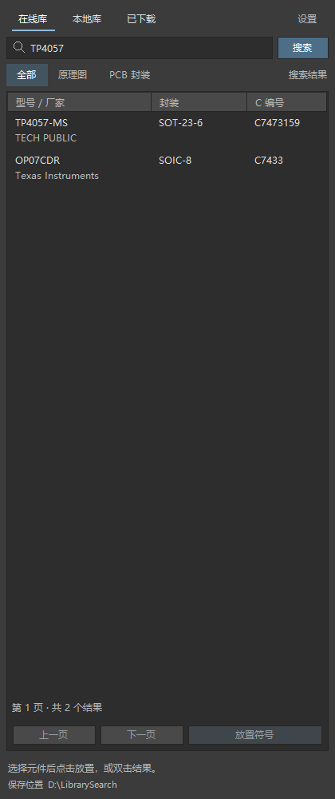

# LibrarySearch

在 Altium Designer 内搜索、获取和放置元件，连接在线库、本地库与已下载元件。

[官网下载](https://ad.kn21.xyz/download.html) · [GitHub Releases](https://github.com/a1659746547/LibrarySearch/releases) · [反馈问题](https://github.com/a1659746547/LibrarySearch/issues)

## 功能

- 在线搜索型号、厂家或 C 编号，获取配套原理图符号和 PCB 封装。
- 自动扫描本地 SchLib、PcbLib、IntLib，支持大库搜索。
- 管理已下载元件、批量删除缓存、按需补齐 3D 模型。
- 默认采用 AD 外观，提供可选的符号视觉设置。
- 兼容多版本 AD，使用同一个 Install.cmd，安装器自动选择对应插件。其他版本可尝试兼容安装并自行验证。

## 安装

1. 从 Releases 或官网下载完整安装包。GitHub 的自动源码 ZIP 是开发源码，不是安装包。
2. 保存工程，关闭全部 AD 实例。
3. 完整解压安装包，运行 **Install.cmd**，选择目标 AD。
4. 打开 AD，在 **Panels → LibrarySearch** 中启用面板。

旧接口使用 .NET Framework 4.8+；现代接口使用 AD 自带的 .NET 6/8。转换器需要 Microsoft Visual C++ x64 运行库。用户不需要安装开发 SDK。

## 源码结构

| 目录 | 内容 |
| --- | --- |
| `plugin/src` | 搜索、缓存、面板、设置、下载和更新逻辑 |
| `plugin/host-source` | 适配不同 AD 接口的插件源码 |
| `converter/easyeda2altium-*` | Rust 主转换器、长孔修复器及本地索引 |
| `converter/dependencies/altiumrs-*` | 随仓库提供的修改版 Altium 文件读写库 |
| `tools` | 构建、打包和验证脚本 |
| `plugin/tests` | 面板、搜索、缓存、安装兼容性等回归检查 |
| `compatibility` | 不变的程序集基线和接口校验信息 |

构建步骤见 [BUILDING.md](BUILDING.md)，更新内容见 [CHANGELOG.md](CHANGELOG.md)。

## 数据与第三方项目

在线元件按需获取自嘉立创EDA / EasyEDA。仓库不包含供应商元件数据库、用户工程、私有缓存或 Altium SDK。软件开源许可不代表第三方元件数据的再分发授权。

### 参考项目与致谢

- [korbin/easyeda2altium](https://github.com/korbin/easyeda2altium)：在线元件获取、EasyEDA 数据解析及 Altium 符号/封装转换的基础。
- [korbin/altiumrs](https://github.com/korbin/altiumrs)：Altium 文件读写基础，用于转换和本地元件库扫描；保留 [issus/altiumrs](https://github.com/issus/altiumrs) 的上游元数据说明。
- [uPesy/easyeda2kicad.py](https://github.com/uPesy/easyeda2kicad.py)：解析器注明的 EasyEDA shape / pin 数据格式参考。

感谢上述项目的贡献。具体使用范围、基线 revision 和参考关系见 [SOURCE_ORIGINS.md](SOURCE_ORIGINS.md)，许可证告知见 [THIRD_PARTY_NOTICES.md](THIRD_PARTY_NOTICES.md)。LibrarySearch 不是 Altium 或嘉立创EDA的官方插件。

## 开源许可

LibrarySearch 原创代码采用 [MIT](LICENSE) 许可。第三方代码及兼容性基线保留各自的许可证与来源说明。
