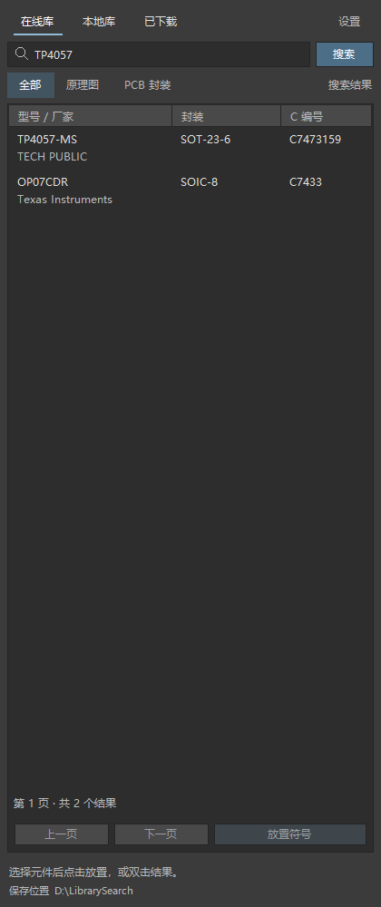

# LibrarySearch

LibrarySearch 是 Altium Designer 的开源元件库插件。在设计界面内搜索在线元件和本地库，获取原理图符号、PCB 封装及可用的 3D 模型，并将元件放入当前设计。

**[下载最新版]( · [更新记录](CHANGELOG.md) · [反馈问题](https://github.com/a1659746547/LibrarySearch/issues) · [赞助开发](https://ad.kn21.xyz/sponsor.html)

## 主要功能

- **在线库**　按厂商料号、制造商或立创商城 C 编号查找元件，获取并放置原理图符号或 PCB 封装。
- **本地库**　搜索已有的 `.SchLib`、`.PcbLib` 和 `.IntLib` 文件。
- **已下载**　复用下载过的元件，管理缓存，并按需补齐可用的 3D 模型。[已下载总库说明](plugin/docs/已下载总库说明.md)

## 安装和使用

**安装包支持 Altium Designer 18、19、20、21、24、25、26。** 统一安装器会根据所选版本安装对应插件。

1. 在最新发布的 **Assets** 中下载 LibrarySearch 安装包并完整解压。[GitHub 最新发布](
2. 保存工程并关闭所有 Altium Designer 窗口，运行 **Install.cmd**，按提示选择目标版本。
3. 重新打开 Altium Designer，从 **Panels → LibrarySearch** 打开面板。
4. 搜索元件并选择原理图符号或 PCB 封装，点击对应的放置按钮。

投板前请按器件规格书核对符号引脚、封装焊盘和 3D 模型方向。

旧接口使用 .NET Framework 4.8+；现代接口使用相应 AD 版本自带的 .NET 运行环境。转换器需要 Microsoft Visual C++ x64 运行库。用户不需要安装开发 SDK。

## 源码结构

| 目录 | 内容 |
| --- | --- |
| `plugin/src` | 搜索、缓存、面板、设置、下载和更新逻辑 |
| `plugin/host-source` | 适配不同 AD 接口的插件源码 |
| `converter/easyeda2altium-*` | Rust 主转换器、长孔修复器及本地索引 |
| `converter/dependencies/altiumrs-*` | 随仓库提供的修改版 Altium 文件读写库 |
| `tools` | 构建、打包和验证脚本 |
| `plugin/tests` | 面板、搜索、缓存、安装兼容性等回归检查 |
| `compatibility` | 不变的程序集基线和接口校验信息 |

构建步骤见 [BUILDING.md](BUILDING.md)，更新内容见 [CHANGELOG.md](CHANGELOG.md)。

## 数据与第三方项目

在线元件按需获取自嘉立创EDA / EasyEDA。仓库不包含供应商元件数据库、用户工程、私有缓存或 Altium SDK。软件开源许可不代表第三方元件数据的再分发授权。

### 参考项目与致谢

- [korbin/easyeda2altium](https://github.com/korbin/easyeda2altium)：在线元件获取、EasyEDA 数据解析及 Altium 符号/封装转换的基础。
- [korbin/altiumrs](https://github.com/korbin/altiumrs)：Altium 文件读写基础，用于转换和本地元件库扫描；保留 [issus/altiumrs](https://github.com/issus/altiumrs) 的上游元数据说明。
- [uPesy/easyeda2kicad.py](https://github.com/uPesy/easyeda2kicad.py)：解析器注明的 EasyEDA shape / pin 数据格式参考。

感谢上述项目的贡献。具体使用范围、基线 revision 和参考关系见 [SOURCE_ORIGINS.md](SOURCE_ORIGINS.md)，许可证告知见 [THIRD_PARTY_NOTICES.md](THIRD_PARTY_NOTICES.md)。LibrarySearch 不是 Altium 或嘉立创EDA的官方插件。

## 开源许可

LibrarySearch 原创代码采用 [MIT](LICENSE) 许可。第三方代码及兼容性基线保留各自的许可证与来源说明。
